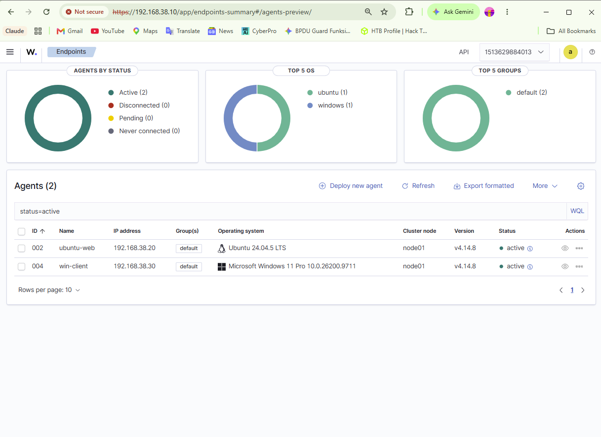

# Mini SOC Lab

**Wazuh · Docker · Linux · Windows · Sysmon**

A three-VM security monitoring lab built to follow an event from its source to a searchable alert, investigate the fields that explain it, and check that collection survives configuration changes and reboots.

**Maintainer:** [Umud-cyber](https://github.com/Umud-cyber) · **Documented build:** Wazuh 4.14.8 · **Evidence period:** 13–16 October 2026


## Contents

- [Project scope](#project-scope)
- [Verified results](#verified-results)
- [Lab inventory](#lab-inventory)
- [Network and service exposure](#network-and-service-exposure)
- [How an event becomes an alert](#how-an-event-becomes-an-alert)
- [Build and configuration](#build-and-configuration)
- [Detection walkthroughs](#detection-walkthroughs)
- [Investigation workflow](#investigation-workflow)
- [Restart and recovery validation](#restart-and-recovery-validation)
- [Operating the lab](#operating-the-lab)
- [Troubleshooting notes](#troubleshooting-notes)
- [Resource usage](#resource-usage)
- [Security decisions and evidence limits](#security-decisions-and-evidence-limits)
- [Repository guide](#repository-guide)
- [Technical references](#technical-references)

## Project scope

This repository documents the deployment and validation of a small Security Operations Center environment in VMware Workstation. An Ubuntu SIEM host runs the Wazuh Manager, Indexer and Dashboard in Docker. A second Ubuntu VM supplies authentication and Nginx web logs. A Windows 11 VM supplies Windows events and Sysmon process telemetry.

The work covers more than bringing up a dashboard: agent enrollment, local event verification, centralized analysis, restricted port publishing, repeatable test events, and recovery after endpoint and SIEM restarts. The screenshots include intermediate failures and earlier configurations so that the changes can be followed.

The test events are controlled lab activity. A failed password, a local account enumeration command or an HTTP 404 can be useful detection evidence without being evidence of an actual intrusion. Interpretation depends on the initiating user, command, source, timing and surrounding activity.

The public evidence set contains **32 original screenshots**, organized by purpose and mapped to their original filenames in the [evidence register](evidence/README.md). One additional source capture contains credential-hash material and is excluded.

## Verified results

| Objective | Observed result | Evidence |
|---|---|---|
| Run the SIEM stack | Manager, Indexer and Dashboard running with image tag `4.14.8` | [E30](evidence/02-platform/final-container-port-bindings.png) |
| Enroll the Linux endpoint | `ubuntu-web`, agent `002`, `192.168.38.20`, Active | [E05](evidence/03-agents/ubuntu-agent-active.png) |
| Enroll the Windows endpoint | `win-client`, agent `004`, `192.168.38.30`, Active | [E09](evidence/03-agents/two-agents-active.png) |
| Collect Windows process telemetry | `net.exe user` and `net.exe localgroup administrators` visible in Discover | [E12](evidence/04-detections/windows-net-user.png), [E13](evidence/04-detections/windows-administrators-enumeration.png) |
| Collect Linux authentication failures | Failed `su` and failed `sudo`/PAM events visible at level 5 | [E14](evidence/04-detections/linux-failed-su.png), [E16](evidence/04-detections/linux-sudo-authentication-failure.png) |
| Collect web access logs | Nginx test requests return 404 and generate rule `31101`, level `5` | [E15](evidence/04-detections/nginx-missing-page.png), [E23](evidence/05-recovery/nginx-alert-after-endpoint-reboot.png) |
| Reduce published service exposure | Dashboard/Manager bound to lab IP; Indexer bound to loopback | [E18](evidence/02-platform/ports-after-hardening.png), [E30](evidence/02-platform/final-container-port-bindings.png) |
| Recover after endpoint restart | Services running and fresh Linux/Windows events visible | [E22–E25](docs/recovery-validation.md) |
| Recover after SIEM restart | Containers running and a fresh Nginx alert received | [E26](evidence/05-recovery/siem-containers-after-reboot.png), [E27](evidence/05-recovery/nginx-alert-after-siem-reboot.png) |

These results are scoped to the captured tests. They do not establish production availability, complete attack coverage or permanent network isolation.

## Lab inventory

### Virtual machines

| Machine | Role | Operating system | Lab IP | Agent ID |
|---|---|---|---|---|
| `siem-host` | Docker host for Wazuh central components | Ubuntu 24.04.5 LTS | `192.168.38.10/24` | Central server |
| `ubuntu-web` | Linux endpoint and Nginx web server | Ubuntu 24.04.5 LTS | `192.168.38.20/24` | `002` |
| `win-client` | Windows endpoint and Sysmon source | Windows 11 Pro | `192.168.38.30/24` | `004` |

The Windows agent name is `win-client`; the underlying computer name in command output is `DESKTOP-TRFU523`. An earlier registration appears as `WIN11` with ID `003` and status Pending. The later Active record is the identity used throughout this documentation.

### Recorded versions and VM sizing

| Component | Captured value | Source |
|---|---|---|
| Wazuh central images and endpoint agents | `4.14.8` | E09, E30 |
| Docker Engine | `29.9.0`, build `f415da8` | E29 |
| Docker Compose | `v5.6.0` | E29 |
| Nginx | `1.24.0` on Ubuntu | E22 |
| SIEM VM allocation | 16 GB RAM, 4 processors, 250 GB disk | E32 |
| Ubuntu endpoint allocation | 2 GB RAM, 2 processors, 40 GB disk | E33 |
| Windows VM allocation | Not established by the supplied settings captures | — |

These are observations from this build, not minimum sizing recommendations. The two VM settings captures do not display the VM names in their title bars; their assignment follows the accompanying lab context. No Windows resource allocation is inferred from them.

## Network and service exposure

The monitoring network is **`192.168.38.0/24`**, connected through VMware Host-only networking. Agents communicate with the SIEM over this segment. VMware NAT uses a separate **`192.168.121.0/24`** segment during setup and maintenance.

| System | Host-only address | NAT address seen during setup |
|---|---|---|
| SIEM | `192.168.38.10` | `192.168.121.151` |
| Ubuntu endpoint | `192.168.38.20` | `192.168.121.152` |
| Windows endpoint | `192.168.38.30` | `192.168.121.146` |

The first SIEM captures show a DHCP address of `192.168.38.130`; later captures establish the final lab address of `.10`. The old address is retained only as build history.

### Final published ports

| Host binding | Container port | Purpose |
|---|---|---|
| `192.168.38.10:443/tcp` | `5601/tcp` | Browser access to Wazuh Dashboard |
| `192.168.38.10:1514/tcp` | `1514/tcp` | Agent event transport |
| `192.168.38.10:1515/tcp` | `1515/tcp` | Agent enrollment |
| `192.168.38.10:55000/tcp` | `55000/tcp` | Wazuh Manager API |
| `192.168.38.10:514/udp` | `514/udp` | Published syslog port; separate syslog-source ingestion was not validated |
| `127.0.0.1:9200/tcp` | `9200/tcp` | Local access to the Indexer API |

The `1516/tcp` entry in Docker output has no host mapping. It is not evidence that TCP 1516 was published on every host interface. Likewise, the Dashboard's standalone `443/tcp` metadata entry should not be confused with the actual host-to-container mapping `443 → 5601`.

Earlier in the build, Docker published services on wildcard addresses (`0.0.0.0` and `::`). The Compose configuration was updated, validated and reapplied, and the final bindings were checked with `docker ps`. See [the exposure change](docs/deployment.md#restricting-published-ports).

NAT-off tests demonstrate alert collection during the documented test sequence. The supplied final screenshots do **not** include route-table evidence proving that both endpoints remained isolated afterward. A later VM settings capture still lists a NAT adapter; listing an adapter alone does not establish whether it is connected. The architecture therefore separates the host-only telemetry path from the maintenance network without claiming an air-gapped lab.

## How an event becomes an alert

1. **The source produces an event.** Examples are a Windows process launch, a Linux authentication failure, or an Nginx access-log entry.
2. **The endpoint agent collects the configured source.** Windows Event Channels and Linux log sources have to be configured for collection; the agent does not indiscriminately forward every possible log.
3. **The Manager analyzes the event.** Decoders extract fields, then the ruleset determines whether the event matches an alert condition and what level to assign.
4. **Alert documents are shipped and indexed.** Filebeat in the Wazuh server stack sends the alert data to the Indexer.
5. **The analyst investigates in the Dashboard.** Discover queries the indexed documents. Agent information and management functions also use the Manager API.

An event present in the local Sysmon log is not automatically an alert in `wazuh-alerts-*`. Collection, rule matching, alert threshold, indexing and the selected time window all matter. The default Wazuh alert logging threshold is level 3; the actual local setting should be checked before diagnosing a missing alert. Details and source references are in [event flow](architecture/event-flow.md).

## Build and configuration

The central stack lives at `~/wazuh-docker/single-node` on `siem-host`. This repository is the lab documentation and evidence repository; it does not contain the private running deployment, its credentials, generated certificates or Docker volumes.

### 1. Prepare networking and the SIEM host

The SIEM was moved from the initial DHCP address to `192.168.38.10/24`. The Linux and Windows endpoints use `.20` and `.30`. Keep the lab interface distinct from the NAT interface when reviewing routing and port bindings.

On the SIEM, the captured kernel prerequisite is:

```bash
sysctl vm.max_map_count
# Captured value: 262144
```

The kernel setting and Git availability are recorded in [E03](evidence/02-platform/indexer-kernel-prerequisite.png). The later Docker checks show the service both active and enabled:

```bash
sudo docker --version
sudo docker compose version
systemctl is-active docker
systemctl is-enabled docker
```

### 2. Start and inspect the single-node stack

```bash
cd ~/wazuh-docker/single-node
sudo docker compose config --quiet
sudo docker compose up -d
sudo docker compose ps -a
sudo docker ps --format 'table {{.Names}}\t{{.Status}}\t{{.Ports}}'
```

The expected services are `wazuh.manager`, `wazuh.indexer` and `wazuh.dashboard`. A running container establishes process state; the Dashboard and fresh-event checks establish that the application path is usable.

### 3. Enroll and verify the Linux agent

The Linux agent points to `192.168.38.10`. Its final record is `ubuntu-web`, ID `002`, group `default`.

```bash
systemctl is-active wazuh-agent nginx
sudo journalctl -u wazuh-agent --no-pager -n 30
sudo tail -n 30 /var/ossec/logs/ossec.log
```

Authentication events in the evidence have `location: journald`. Nginx events have `location: /var/log/nginx/access.log`. The [configuration notes](configs/README.md) include minimal source examples, clearly separated from captured configuration.

### 4. Enroll and verify the Windows agent

The installation capture uses Wazuh agent `4.14.8-1`, manager `192.168.38.10`, and requested agent name `win-client`. Service state, registration state and actual event arrival were checked separately.

```powershell
Test-NetConnection 192.168.38.10 -Port 1515
Test-NetConnection 192.168.38.10 -Port 1514
Get-Service WazuhSvc, Sysmon64
Get-WinEvent -FilterHashtable @{
    LogName = 'Microsoft-Windows-Sysmon/Operational'
    Id = 1
} -MaxEvents 5 | Format-List TimeCreated, Id, Message
```

E06 directly captures the enrollment-port check on TCP 1515. The TCP 1514 command above is a repeatable operational check, not a claim that its output appears in that same screenshot.



*Both endpoint agents are Active after the service bindings were restricted.*

## Detection walkthroughs

### Windows account enumeration

**Action:** run a small, read-only command in the Windows lab VM:

```powershell
net user
net localgroup administrators
```

**Observed:** the corresponding `net.exe` process documents are available in Discover. The captures show the executable image, command line, working directory, integrity level and process identifiers. Later captures also show the PowerShell parent and `CORP\prod1` user context. That context belongs to the captured Windows VM; this project does not claim to have deployed an Active Directory infrastructure.

**Investigation:** the command line distinguishes account listing from other uses of `net.exe`. The parent process and user help establish whether the action was expected. A command executed by an administrator during testing is a different situation from the same command appearing after an unexpected remote login.

```text
agent.name:"win-client" AND data.win.system.eventID:"1" AND data.win.eventdata.originalFileName:"net.exe"
```

Evidence: [account listing](evidence/04-detections/windows-net-user.png), [administrator-group enumeration](evidence/04-detections/windows-administrators-enumeration.png), [command and event side by side](evidence/05-recovery/windows-nat-off-test.png).

The exact Windows alert rule ID and level are not visible in the relevant expanded field views. They are deliberately not guessed. The alert document's image and command line provide the evidence for this test.

### Linux failed user switch

**Action:** perform a controlled `su` authentication attempt in the Ubuntu VM and enter an incorrect password.

**Observed:** a journald event contains `FAILED SU (to umud) umud on tty1`. Wazuh identifies the `su` program and reports a failed UID-change password event at level `5`.

```text
agent.name:"ubuntu-web" AND predecoder.program_name:"su" AND rule.level:5
```

**Investigation:** read the source and target user, terminal, full message and nearby authentication activity. A single deliberate failed password is a validation event, not enough to conclude brute force or privilege escalation.

Evidence: [E14 — failed su](evidence/04-detections/linux-failed-su.png).

### Linux failed sudo authentication

**Action:** trigger one failed sudo authentication attempt. On a repeat test, an existing sudo credential cache can be invalidated with `sudo -k` before running `sudo -v` and entering an incorrect password.

**Observed:** the log is from `sudo` and contains `pam_unix(sudo:auth): authentication failure`. The decoded alert description is `PAM: User login failed.` at level `5`; the source user is `umud` and the terminal is `/dev/tty1`.

```text
agent.name:"ubuntu-web" AND predecoder.program_name:"sudo" AND rule.groups:"authentication_failed"
```

**Investigation:** the description is broad, so the originating program is necessary to distinguish a sudo failure from SSH, a console login or another PAM consumer. This screenshot proves a failed sudo authentication event; it does not prove a successful privileged command.

Evidence: [E16 — sudo/PAM failure](evidence/04-detections/linux-sudo-authentication-failure.png).

### Nginx missing-page detection

**Action:** request a deliberately nonexistent page on the Ubuntu web server:

```bash
curl -i http://127.0.0.1/soc-test-missing-page
```

**Observed:** Nginx returns HTTP `404`; the agent reads its access log; Wazuh decodes the request and generates a web alert. Later repeat captures expose the full rule details:

| Field | Observed value |
|---|---|
| `agent.name` | `ubuntu-web` |
| `agent.id` | `002` |
| `location` | `/var/log/nginx/access.log` |
| `decoder.name` | `web-accesslog` |
| `data.srcip` | `127.0.0.1` |
| `data.protocol` | `GET` |
| `data.id` | `404` |
| `rule.id` | `31101` |
| `rule.level` | `5` |
| `rule.description` | `Web server 400 error code.` |

The generic rule description refers to a class of client-error responses. The specific HTTP status is in `data.id`; here it is **404**, not 400. The source IP is loopback because the request was generated locally with curl.

```text
agent.name:"ubuntu-web" AND rule.id:"31101" AND data.url:"/soc-test-missing-page"
```

Evidence: [initial missing-page alert](evidence/04-detections/nginx-missing-page.png), [complete rule fields after reboot](evidence/05-recovery/nginx-alert-after-endpoint-reboot.png).

## Investigation workflow

1. Open Discover and select the alert index pattern used in the build (`wazuh-alerts-*`; the backing documents are in `wazuh-alerts-4.x-*`).
2. Set an explicit time range around the test. October captures will not appear in a current “Last 15 minutes” window.
3. Filter by `agent.name` or the verified ID. The final Windows ID is `004`, not the earlier pending registration `003`.
4. Start with a broad source query and narrow to the event, command or URL. Avoid assuming that every local event must already have an alert document.
5. Expand the matching document. Record the full log, source, event fields and rule information together.
6. Compare the observation with the command that generated it and examine nearby events if the behavior was unexpected.

Useful columns are `timestamp`, `agent.name`, `rule.id`, `rule.level`, `rule.description`, `location`, and the relevant command-line or URL field. Sort the time column descending when looking for the latest test.

The lab's Nginx records show UTC in the raw access log and a four-hour-later value in Discover. For example, the SIEM-reboot test is recorded at `13:10:02 +0000` in the source and displayed around `17:10:03.722` in the Dashboard. Account for timezone display and collection delay when comparing them. The early Windows local-event capture has a different local/UTC offset and is not accepted as synchronization evidence.

See [the query guide](queries/README.md) for reusable DQL searches and field interpretation.

## Restart and recovery validation

The checks use distinct URLs so that a fresh event can be distinguished from a previously indexed record.

| Stage | Test marker or action | Captured result |
|---|---|---|
| NAT-off test sequence | `/soc-test-without-nat`; Windows `net user` | Matching Linux and Windows documents received |
| Ubuntu endpoint reboot | `/soc-test-after-reboot` | Agent and Nginx active; fresh rule `31101` alert |
| Windows recovery check | `Get-Service WazuhSvc, Sysmon64`; `net user` | Both services Running; fresh process event |
| SIEM reboot | `/soc-test-siem-reboot` | Docker active, all three containers Up, fresh web alert |
| Restart configuration | `docker inspect` | `always` for Manager, Indexer and Dashboard |

The tests establish recovery of service state and fresh ingestion. They are not a quantified retention test, a restore-from-backup test or an availability measurement. A dedicated historical-event comparison would be needed to demonstrate retention over a defined interval.

The complete sequence, commands and individual images are in [recovery validation](docs/recovery-validation.md).

## Operating the lab

### Start a session

Start `siem-host`, then verify the stack before starting the endpoints:

```bash
cd ~/wazuh-docker/single-node
systemctl is-active docker
sudo docker compose up -d
sudo docker compose ps -a
curl -k -I --max-time 10 https://192.168.38.10/
```

An HTTP redirect to the login page is a useful Dashboard reachability check. `-k` is used only for this local lab check because the browser does not trust the lab certificate by default; it skips certificate validation.

Start `ubuntu-web` and `win-client`, confirm both agents are Active, and generate a small test event. Open **`https://192.168.38.10/`** from the VMware host.

### End a session

Shut down the endpoint VMs cleanly, then stop the SIEM services before powering off the SIEM VM:

```bash
cd ~/wazuh-docker/single-node
sudo docker compose stop
sudo poweroff
```

`stop` preserves the existing containers and their volumes. Do not use `docker compose down -v` as a normal shutdown command: it removes the Compose-managed volumes. Docker's `always` policy does not immediately undo a manual stop; the containers can start again when the daemon restarts or when explicitly started.

### Inspect a problem

```bash
cd ~/wazuh-docker/single-node
sudo docker compose ps -a
sudo docker compose logs --tail=100 wazuh.manager
sudo docker compose logs --tail=100 wazuh.indexer
sudo docker compose logs --tail=100 wazuh.dashboard
sudo docker stats --no-stream
```

The [operations runbook](docs/operations.md) explains what each check establishes and how to avoid confusing process health with event delivery.

## Troubleshooting notes

| Symptom | Finding | Resolution or next diagnostic |
|---|---|---|
| Dashboard timed out while containers were running | The earlier troubleshooting record identified a missing IPv4 address on the Docker bridge | Restored the bridge address; later capture shows `172.18.0.1/16` and HTTP 302. Confirm the actual Docker subnet before applying any bridge change. |
| Windows service Running, agent still Pending | Service state alone did not establish working enrollment | Final record became `win-client`, ID `004`, Active; centralized events were then verified. The exact registration repair is not exposed by the images. |
| A local Sysmon event did not appear in the alert view | Local event generation and alert generation are different checks | Inspect collection, rule matching, threshold, index and time range; use the captured `net.exe` test as a known working comparison. |
| Ports exposed on wildcard addresses | Initial Docker mappings used `0.0.0.0` / `::` | Replaced bindings with the host-only SIEM IP and loopback Indexer binding, then reapplied Compose. |
| Conflicting times between screenshots and event fields | Capture filename, OS local time, UTC source time and Dashboard display are different values | Compare explicit event fields and timezone settings; do not infer synchronization from the filename. |
| Nginx “400” rule description for a 404 request | Generic rule name differs from the specific response code | Use `data.id:404` and the raw access-log line. |

The [troubleshooting record](docs/troubleshooting.md) separates directly captured results from details recovered from the earlier lab discussion.

## Resource usage

The final sample was taken with all three services running. It is a point-in-time reading, not a benchmark.

| Container | CPU | Memory used |
|---|---:|---:|
| Dashboard | 0.12% | 190.4 MiB |
| Indexer | 2.02% | 1.434 GiB |
| Manager | 1.38% | 332.2 MiB |

All three lines show a `15.57 GiB` memory limit corresponding to the visible Docker host memory in the capture. This is not evidence of a separate 15.57 GiB reservation for each container. The observed container use totals about 1.94 GiB, excluding the VM operating system and other processes.

Evidence: [E31 — resource sample and restart policies](evidence/02-platform/resources-and-restart-policy.png).

## Security decisions and evidence limits

- **Restricted host bindings:** Manager and Dashboard ports use the host-only SIEM address; the Indexer host port is loopback-only. This reduces exposure but does not replace authentication or firewall review.
- **Separate maintenance path:** NAT was used for setup; NAT-off telemetry tests are recorded. Permanent isolation still requires current adapter and route evidence.
- **Credentials excluded:** passwords, password hashes, enrollment keys, private keys and generated deployment credentials are not included. The credential-maintenance screenshot is omitted in full.
- **Original evidence preserved:** public screenshots are copied byte-for-byte, with original names and SHA-256 values recorded in the manifest.
- **No invented detections:** the repository claims only the Windows, Linux and web tests shown. It does not claim successful SSH brute-force detection, custom Notepad rules, registry persistence, C2 detection or automated containment for this build.
- **No unverified deployment export:** example configuration fragments are marked as examples. The private running `ossec.conf`, Compose file and Sysmon configuration were not supplied as files.
- **Clock and retention limits:** synchronized clocks, historical retention over a defined period, and backup restoration require additional evidence.

## Repository guide

| Location | Purpose |
|---|---|
| [architecture/](architecture/README.md) | Network diagram, addressing and event-flow explanation |
| [docs/deployment.md](docs/deployment.md) | Build stages, source configuration and port-binding change |
| [docs/operations.md](docs/operations.md) | Start, stop and health-check runbook |
| [docs/recovery-validation.md](docs/recovery-validation.md) | NAT-off and reboot test sequence |
| [docs/troubleshooting.md](docs/troubleshooting.md) | Symptoms, findings, fixes and remaining evidence gaps |
| [queries/](queries/README.md) | DQL searches for the captured tests |
| [configs/](configs/README.md) | Minimal, credential-free configuration examples |
| [evidence/](evidence/README.md) | 32 screenshots grouped by phase, with a source manifest |
| [journal.md](journal.md) | Dated implementation and validation record |

## Technical references

The project narrative and results come from this lab's screenshots. The following primary sources explain the underlying platform behavior:

- [Wazuh architecture](https://documentation.wazuh.com/current/getting-started/architecture.html)
- [Wazuh Docker deployment](https://documentation.wazuh.com/current/deployment-options/docker/wazuh-container.html)
- [Wazuh Docker utilities](https://documentation.wazuh.com/current/deployment-options/docker/container-usage.html)
- [Wazuh log-source configuration](https://documentation.wazuh.com/current/user-manual/reference/ossec-conf/localfile.html)
- [Wazuh alert threshold](https://documentation.wazuh.com/current/user-manual/reference/ossec-conf/alerts.html)
- [Microsoft Sysmon documentation](https://learn.microsoft.com/en-us/sysinternals/downloads/sysmon)
- [Docker restart policy behavior](https://docs.docker.com/engine/containers/start-containers-automatically/)
- [Docker Compose restart behavior](https://docs.docker.com/reference/cli/docker/compose/restart/)

The organization of the reference [Mini-SOC-Lab repository](https://github.com/CyR4ku/Mini-SOC-Lab) informed the separation of architecture, evidence and journal material. This repository uses its own lab details, screenshots, diagrams and explanations. External references are not project contributors.
