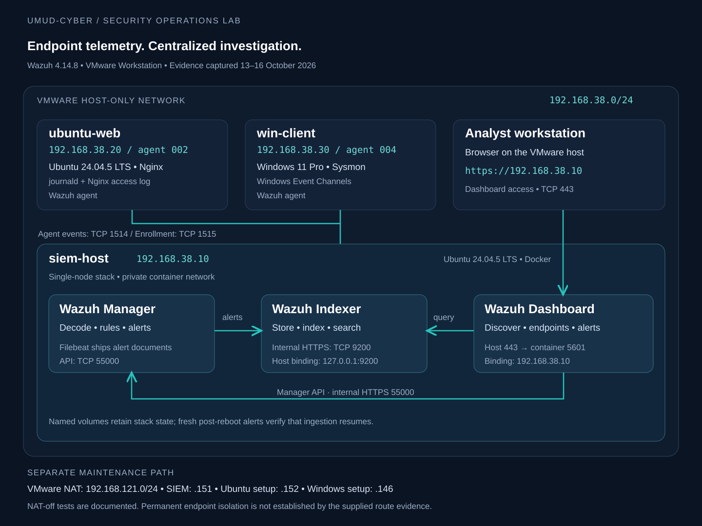

# Architecture

[Back to project](../README.md)

The topology distinguishes endpoint telemetry, the private container network and the separate NAT maintenance segment. It represents the final service bindings shown in E30, while retaining the uncertainty about the endpoint NAT adapter state.

## Address plan

| Interface or segment | Address | Use |
|---|---|---|
| VMware Host-only | `192.168.38.0/24` | Analyst access and agent-to-Manager communication |
| `siem-host` host-only (`ens34` in E04) | `192.168.38.10/24` | Dashboard, enrollment and event collection |
| `ubuntu-web` host-only | `192.168.38.20/24` | Linux and web telemetry |
| `win-client` host-only | `192.168.38.30/24` | Windows and Sysmon telemetry |
| VMware NAT | `192.168.121.0/24` | Setup and maintenance access |
| SIEM NAT (`ens33` in E04) | `192.168.121.151/24` | SIEM maintenance |
| Ubuntu NAT during setup | `192.168.121.152/24` | Endpoint installation and updates |
| Windows NAT during setup | `192.168.121.146/24` | Endpoint installation and updates |
| Docker Compose bridge in the recovery capture | `172.18.0.1/16` | Container-network gateway on the SIEM host |
| Docker default bridge in E04 | `172.17.0.1/16` | Separate default Docker network; shown Down |

The Docker subnets are internal virtual networks; they are not additional endpoint LANs. The diagram does not assign fixed container IPs because they were not supplied as a stable configuration.

## Reading the network history

- [E01](../evidence/01-network/vmware-host-only-dhcp.png) and [E02](../evidence/01-network/siem-initial-interfaces.png) show the initial SIEM DHCP address `.130`.
- [E04](../evidence/02-platform/dashboard-connectivity-restored.png) shows the final `.10` address and restored Docker bridge.
- [E06](../evidence/01-network/windows-enrollment-port.png) shows a Windows NAT default route and a successful TCP 1515 test sourced from the host-only address.
- [E18](../evidence/02-platform/ports-after-hardening.png) and [E30](../evidence/02-platform/final-container-port-bindings.png) establish the restricted published ports.
- [E33](../evidence/00-virtual-machines/ubuntu-vm-settings.png) lists both NAT and host-only adapters; the NAT adapter's connection state is not selected in that image.

A port bound to `127.0.0.1` cannot be reached through the host's LAN address using that binding. This does not stop the Dashboard and Manager from reaching the Indexer through the Docker network. Host port publishing and container-to-container networking are separate mechanisms.

## Diagram files

The [SVG](network-topology.svg) is the editable source and the README rendering asset. [Event flow](event-flow.md) explains the pipeline independently of VM placement. A PNG rendering is also included for viewers that do not display SVG.
