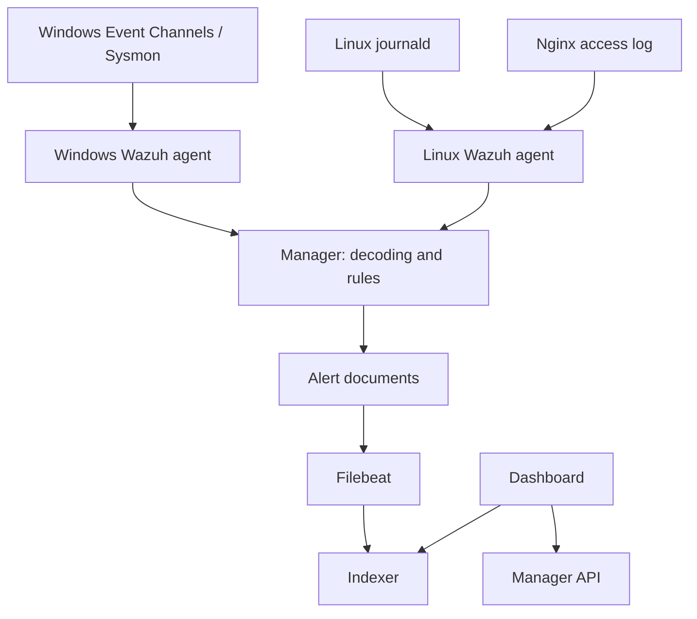

# Event collection and analysis

[Architecture](README.md) · [Project](../README.md)

## Responsibilities

| Layer | Responsibility | Evidence or diagnostic |
|---|---|---|
| Source | Produce a local log entry | `Get-WinEvent`, `journalctl`, Nginx access log |
| Agent | Read configured sources and transport events | Agent service, `ossec.log`, Active status |
| Manager | Decode events and evaluate rules | `decoder.name`, parsed fields, `rule.*` |
| Alert output | Store rule matches meeting logging criteria | Manager alert output and threshold configuration |
| Filebeat / Indexer | Ship and index alert documents | Indexer health and searchable alert indices |
| Dashboard | Search and present data; manage through API | Discover results and endpoint inventory |

The diagram shows data and query direction. Dashboard-to-Indexer is a search request; returned results are implicit. Filebeat is part of the Wazuh server deployment here, not a fourth dedicated VM.

## Why local events and indexed alerts differ

A source can record activity that does not appear in the alert index. Check each stage before concluding that the whole pipeline is broken. A process may be filtered by the Sysmon configuration, excluded from agent collection, matched only by a low-level rule, or omitted from the current search because of the selected time range.

The Wazuh default `log_alert_level` is `3`. That setting controls which alerts are written; it does not mean the agent collects only events it already knows are level 3 or above. The Manager assigns rule levels. This repository has no exported Manager configuration, so the default is explanatory context rather than a verified local setting.

During the earlier troubleshooting discussion, `ipconfig` was present locally but absent from the alert view. The public capture set demonstrates working Windows collection using `net.exe` instead. No custom rule is included or claimed.

## One request, followed through the fields

For the post-SIEM-reboot Nginx test:

1. The local client requests `/soc-test-siem-reboot` and receives 404.
2. Nginx writes the request to its access log with source `127.0.0.1`.
3. The Linux agent sends the entry to the Manager as agent `002`.
4. The `web-accesslog` decoder exposes the method, URL, source IP and response code.
5. Rule `31101` produces a level-5 alert.
6. Discover displays the indexed document with the original line and decoded fields.

The [expanded document](../evidence/05-recovery/nginx-alert-after-siem-reboot.png) connects these observations. A single local 404 demonstrates the pipeline; it is not proof of hostile web scanning.

Sources: [Wazuh architecture](https://documentation.wazuh.com/current/getting-started/architecture.html), [alert configuration](https://documentation.wazuh.com/current/user-manual/reference/ossec-conf/alerts.html), [log sources](https://documentation.wazuh.com/current/user-manual/reference/ossec-conf/localfile.html).
