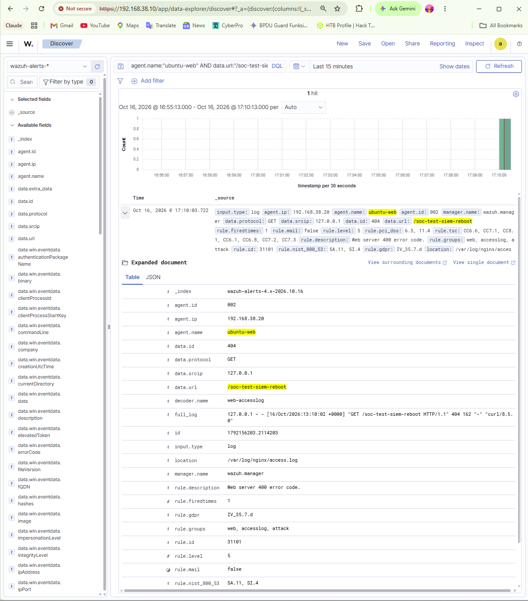

# Recovery and continuity validation

[Back to project](../README.md)

The validation sequence checks whether fresh endpoint activity reaches the SIEM after changes. It separates service recovery from event delivery: a running service is necessary, but the new indexed event is the stronger observation.

## Test sequence

| Stage | Evidence | Result | Scope |
|---|---|---|---|
| Apply restricted port bindings | [E18](../evidence/02-platform/ports-after-hardening.png) | Compose succeeds; host bindings change | Configuration and container state |
| Verify agents after change | [E19](../evidence/03-agents/agents-after-port-hardening.png) | Both agents Active | Registration/connectivity state at capture time |
| Linux NAT-off test | [E20](../evidence/05-recovery/nginx-nat-off-test.png) | `/soc-test-without-nat` alert indexed | Fresh delivery during documented test sequence |
| Windows NAT-off test | [E21](../evidence/05-recovery/windows-nat-off-test.png) | `net user` and matching event shown together | Windows process delivery |
| Ubuntu restart check | [E22](../evidence/05-recovery/ubuntu-services-after-reboot.png) | Agent and Nginx active; HTTP 404 generated | Endpoint service state and event generation |
| Ubuntu post-restart alert | [E23](../evidence/05-recovery/nginx-alert-after-endpoint-reboot.png) | `/soc-test-after-reboot`, rule 31101 | Fresh Linux delivery |
| Windows restart check | [E24](../evidence/05-recovery/windows-services-after-reboot.png) | WazuhSvc and Sysmon64 Running | Endpoint service state |
| Windows post-restart alert | [E25](../evidence/05-recovery/windows-alert-after-reboot.png) | New `net.exe user` document | Fresh Windows delivery |
| SIEM restart check | [E26](../evidence/05-recovery/siem-containers-after-reboot.png) | Docker active; all three containers recently started | Central service recovery |
| SIEM post-restart alert | [E27](../evidence/05-recovery/nginx-alert-after-siem-reboot.png) | `/soc-test-siem-reboot`, rule 31101 | Fresh delivery after central restart |
| Restart policies | [E31](../evidence/02-platform/resources-and-restart-policy.png) | `always` on every central container | Recorded restart configuration |

## Repeating the web checks

Run each command on `ubuntu-web` at its corresponding stage. The requested path should remain nonexistent so that Nginx returns the intended 404 response.

```bash
curl -i http://127.0.0.1/soc-test-without-nat
curl -i http://127.0.0.1/soc-test-after-reboot
curl -i http://127.0.0.1/soc-test-siem-reboot
```

Do not run all three together and infer three recovery tests. Perform the relevant change or reboot, verify service state, then generate the stage-specific request. Record a timestamp or append a unique suffix for a later session so that previous events cannot be mistaken for new results.

Example search for the captured SIEM-reboot test:

```text
agent.name:"ubuntu-web" AND data.url:"/soc-test-siem-reboot" AND rule.id:"31101"
```



## What the evidence establishes

The named test events arrived after the documented recovery steps. The final SIEM output also retains the lab-address and loopback port mappings. The Windows service and event captures establish that both the sensor and agent were functioning during the recovery check.

The endpoint screenshots alone do not expose boot IDs or uptime. Their placement after endpoint reboot follows the captured test sequence and earlier lab discussion. The SIEM output directly shows recently started containers. The documentation preserves that distinction.

## What remains outside this test

**Permanent isolation:** `/soc-test-without-nat` is a useful marker but cannot prove that NAT was disabled. A repeatable isolation assessment should capture current adapter connection states, Linux `ip route`, Windows `route print -4`, continued Manager connectivity and an external-connectivity check. Earlier E06 explicitly shows a Windows NAT default route.

**Historical retention:** finding a new event after a reboot does not prove that every older event survived. Record an old document's index and ID before restart, then retrieve that same document afterward for a dedicated retention test.

**Backup recovery:** these are restarts of the existing installation. No separate backup, clean restore or disaster-recovery test is established.

**Availability:** screenshots do not measure recovery time or event loss. Such claims require timed measurements and source-to-destination counts.
